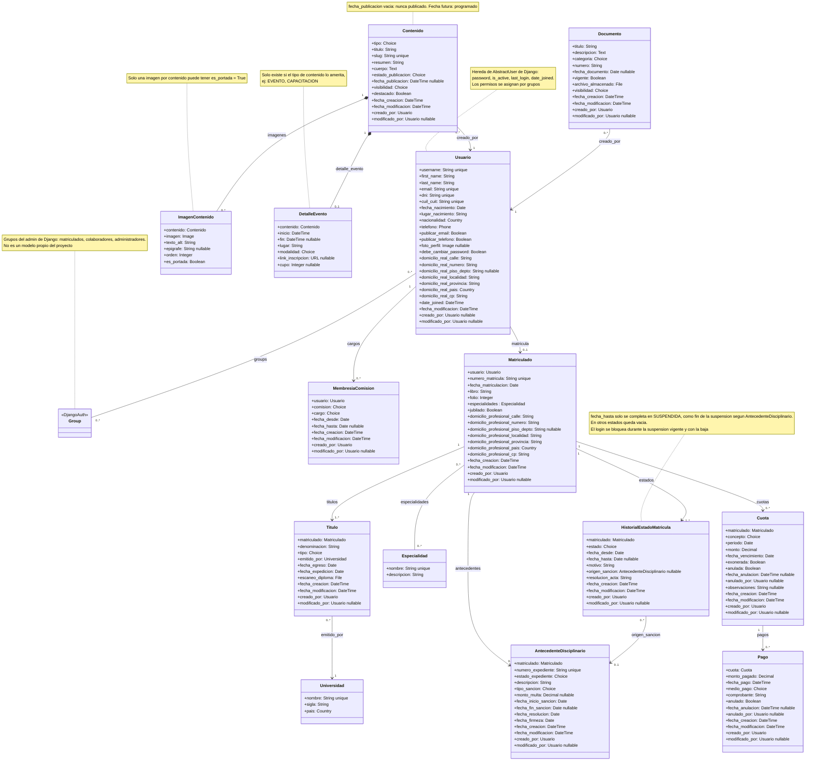

# Base de datos del Colegio de Geólogos de Catamarca

## *Cómo leer este documento*

Describe, modelo por modelo, qué información guarda el sistema y para qué sirve cada campo. Está pensado para tres lectores: personas sin conocimientos técnicos (alcanza con leer la columna «Descripción»), quien desarrolla el sistema y agentes de código (la columna «Tipo» y las reglas indican cómo implementarlo). Los nombres de modelos y campos son los del diagrama UML y deben respetarse tal cual en el código.

## *Convenciones*

* **Tipos**: String (texto corto), Text (texto largo), Integer (número entero), Decimal (importe), Boolean (verdadero o falso), Date (fecha), DateTime (fecha y hora), Choice (lista cerrada de valores, escritos en MAYÚSCULAS y sin acentos), Country (país), Phone (teléfono internacional), URL (enlace web), Image y File (archivo guardado en Supabase Storage; la base de datos solo conserva su referencia).

* **Relación → Modelo**: el campo enlaza con un registro de ese modelo. La tabla de relaciones del final detalla la cardinalidad de cada una.

* **Opcional**: el campo puede quedar vacío. Qué otros campos admiten vacío está pendiente de revisar (ver «Decisiones pendientes»).

* **Automático**: lo completa el sistema, no la persona.

* **Clasificación de datos**: (Público) indica un dato que puede/debe mostrarse públicamente; (Ley 25.326) un dato personal protegido por la Ley de Protección de Datos Personales; (Sensible) un documento sensible. Es la clasificación definida por el autor del proyecto.

## *Reglas generales*

* **Roles**: se manejan con los grupos de Django matriculados, colaboradores y administradores. Los colaboradores generan contenido (noticias, novedades, eventos, etc.). Los administradores tambien generan contenido, pueden crear instancias de todos los modelos y subir documentos.

* **Inicio de sesión**: un matriculado con estado BAJA, o con una suspensión vigente, no puede iniciar sesión. Al terminar la suspensión recupera el acceso.

* **Visibilidad** (campo visibilidad de Contenido y Documento): PUBLICO lo ve cualquier visitante, incluso sin sesión; MATRICULADOS lo ven los usuarios con sesión iniciada del grupo matriculados; INTERNO lo ven solo colaboradores y administradores. Colaboradores y administradores ven todo, incluidos los borradores.

* **Fechas automáticas**: fecha\_creacion se completa una sola vez al crear el registro y fecha\_modificacion se renueva en cada modificación.

* **Archivos**: foto\_perfil, escaneo\_diploma, imagen y archivo\_almacenado se guardan en Supabase Storage.

# 

# Modelos

# **Usuario**

Toda persona con acceso al sistema: matriculados, colaboradores y administradores. Extiende el usuario estándar de Django (AbstractUser), que ya aporta contraseña, estado activo, último acceso y fecha de alta. El rol se define con los grupos. Un usuario puede o no ser matriculado.

| Campo | Tipo | Descripción |
| :---- | :---- | :---- |
| username | String, único | Nombre con el que la persona inicia sesión. Lo aporta AbstractUser. |
| first\_name | String | Nombre de pila. Lo aporta AbstractUser. (Público) |
| last\_name | String | Apellido. Lo aporta AbstractUser. (Público) |
| email | String, único | Correo electrónico. Obligatorio. Se guarda normalizado en minúsculas. Lo aporta AbstractUser. |
| dni | String, único | Número de documento de identidad. (Ley 25.326) |
| cuil\_cuit | String, único | Clave única de identificación laboral o tributaria (CUIL o CUIT). (Ley 25.326) |
| fecha\_nacimiento | Date | Fecha de nacimiento. (Ley 25.326) |
| lugar\_nacimiento | String | Lugar de nacimiento en texto libre, por ejemplo «Localidad, Provincia, País». (Ley 25.326) |
| nacionalidad | Country | País de nacionalidad. Por defecto Argentina («AR»). |
| telefono | Phone | Teléfono de contacto, guardado en formato internacional (E.164). |
| publicar\_email | Boolean | Si es verdadero, el correo puede mostrarse públicamente. Por defecto falso. |
| publicar\_telefono | Boolean | Si es verdadero, el teléfono puede mostrarse públicamente. Por defecto falso. |
| foto\_perfil | Image, opcional | Foto de perfil de la persona. |
| debe\_cambiar\_password | Boolean | Si es verdadero, el sistema obliga a cambiar la contraseña en el próximo inicio de sesión. Por defecto verdadero, para que la contraseña inicial siempre se reemplace. |
| domicilio\_real\_calle | String | Domicilio donde vive la persona. (Ley 25.326) |
| domicilio\_real\_numero | String | Domicilio donde vive la persona. (Ley 25.326) |
| domicilio\_real\_piso\_depto | String, opcional | Domicilio donde vive la persona. (Ley 25.326) |
| domicilio\_real\_localidad | String | Domicilio donde vive la persona. (Ley 25.326) |
| domicilio\_real\_provincia | String | Domicilio donde vive la persona. (Ley 25.326) |
| domicilio\_real\_pais | Country | Domicilio donde vive la persona. (Ley 25.326) |
| domicilio\_real\_cp | String | Domicilio donde vive la persona. (Ley 25.326) |
| date\_joined | DateTime, automático | Fecha y hora en que se creó la cuenta. Lo aporta AbstractUser. |
| fecha\_modificacion | DateTime, automático | Fecha y hora de la última modificación de la cuenta. |
| creado\_por | Relación → Usuario | Quien dio de alta esta cuenta. |
| modificado\_por | Relación → Usuario, opcional | Quien modifico esta cuenta. |

# **MembresiaComision**

Cargo que ocupa una persona en una comisión del Colegio durante un período, por ejemplo presidente de la Comisión Directiva entre dos fechas. Un usuario puede tener varios cargos a lo largo del tiempo.

| Campo | Tipo | Descripción |
| :---- | :---- | :---- |
| usuario | Relación → Usuario | Persona que ocupa el cargo. |
| comision | Choice | Comisión a la que pertenece el cargo: DIRECTIVA. |
| cargo | Choice | Puesto dentro de la comisión: PRESIDENTE, VICEPRESIDENTE, SECRETARIO, PROSECRETARIO, TESORERO, PROTESORERO, VOCAL\_TITULAR, VOCAL\_SUPLENTE. |
| fecha\_desde | Date | Fecha en que la persona asume el cargo. |
| fecha\_hasta | Date, opcional | Fecha en que la persona deja el cargo. |
| fecha\_creacion | DateTime | Fecha y hora en que se creó. |
| fecha\_modificacion | DateTime | Fecha y hora de la última modificación. |
| creado\_por | Relación → Usuario | Quien creo. |
| modificado\_por | Relación → Usuario, opcional | Quien modifico. |

# **Matriculado**

Registro matricular de un profesional habilitado por el Colegio. Amplía a Usuario: toda persona matriculada es primero un usuario, pero no todo usuario es matriculado (por ejemplo, un colaborador). Debe tener al menos un título y al menos un registro de estado.

| Campo | Tipo | Descripción |
| :---- | :---- | :---- |
| usuario | Relación → Usuario, uno a uno, clave primaria | Vincula el registro matricular con la cuenta base. Es la clave primaria: una persona no puede tener dos registros matriculares. |
| numero\_matricula | String, único | Número de matrícula asignado por el Colegio. (Público) |
| fecha\_matriculacion | Date | Fecha formal de alta en el registro del Colegio. |
| libro | String | Referencia física del libro institucional donde se asentó la matrícula. |
| folio | Integer | Número de folio (página) del libro donde consta la matrícula. |
| especialidades | Relación muchos a muchos → Especialidad | Áreas de especialización del matriculado. Puede tener varias o ninguna. |
| jubilado | Boolean | Indica si el matriculado está jubilado. Por defecto falso. |
| domicilio\_profesional\_calle | String | Domicilio donde ejerce el profesional. (Público) |
| domicilio\_profesional\_numero | String | Domicilio donde ejerce el profesional. (Público) |
| domicilio\_profesional\_piso\_depto | String, opcional | Domicilio donde ejerce el profesional. (Público) |
| domicilio\_profesional\_localidad | String | Domicilio donde ejerce el profesional. (Público) |
| domicilio\_profesional\_provincia | String | Domicilio donde ejerce el profesional. (Público) |
| domicilio\_profesional\_pais | Country | Domicilio donde ejerce el profesional. (Público) |
| domicilio\_profesional\_cp | String | Domicilio donde ejerce el profesional. (Público) |
| fecha\_creacion | DateTime, automático | Cuándo se creó la matrícula en el sistema. |
| fecha\_modificacion | DateTime, automático | Cuándo se modificó por última vez la matrícula. |
| creado\_por | Relación → Usuario | Usuario que cargó la matrícula. |
| modificado\_por | Relación → Usuario, opcional | Usuario que modificó la matrícula. |

# **Titulo**

Título universitario con el que un matriculado accede a la matrícula. Cada matriculado tiene al menos uno.

| Campo | Tipo | Descripción |
| :---- | :---- | :---- |
| matriculado | Relación → Matriculado | Titular del título. |
| denominacion | String | Nombre del título, por ejemplo «Licenciado en Geología». |
| tipo | Choice | Nivel del título: PREGRADO, GRADO, POSGRADO. |
| emitido\_por | Relación → Universidad | Institución que emitió el título. |
| fecha\_egreso | Date | Fecha en que la persona terminó la carrera. |
| fecha\_expedicion | Date | Fecha en que la universidad expidió el diploma. |
| escaneo\_diploma | File | Copia digital del diploma. (Sensible) |
| fecha\_creacion | DateTime, automático | Cuándo se cargó el título en el sistema. |
| fecha\_modificacion | DateTime, automático | Cuándo se modificó por última vez. |
| creado\_por | Relación → Usuario | Usuario que cargó el título. |
| modificado\_por | Relación → Usuario, opcional | Usuario que modificó el título. |

# **Universidad**

Catálogo de instituciones que emiten títulos. Se elige al cargar un título.

| Campo | Tipo | Descripción |
| :---- | :---- | :---- |
| nombre | String, único | Nombre completo de la universidad. |
| sigla | String | Sigla de la universidad, por ejemplo «UNCa». |
| pais | Country | País de la universidad. Por defecto Argentina («AR»). |

# **Especialidad**

Catálogo de las áreas de especialización de la geología que pueden tener los matriculados.

| Campo | Tipo | Descripción |
| :---- | :---- | :---- |
| nombre | String, único | Denominación única de la especialización técnica o científica dentro de la geología. |
| descripcion | String | Explicación breve de en qué consiste la especialidad. |

# **HistorialEstadoMatricula**

Historial cronológico del estado de la matrícula (activa, suspendida o de baja). Cada cambio de estado agrega una fila. Por matriculado hay una sola fila «vigente»: la que rige hoy. Esa fila decide si la persona puede iniciar sesión.

| Campo | Tipo | Descripción |
| :---- | :---- | :---- |
| matriculado | Relación → Matriculado | Matriculado al que corresponde el estado. |
| estado | Choice | Estado del ejercicio profesional: ACTIVA, SUSPENDIDA, BAJA. (Público) |
| fecha\_desde | Date | Fecha desde la que rige el estado. |
| fecha\_hasta | Date, opcional | Solo se completa en SUSPENDIDA: es la fecha en que termina la suspensión, según el antecedente disciplinario. En los demás estados queda vacía. |
| motivo | String | Razón del cambio de estado, por ejemplo una sanción o un pedido del propio matriculado. |
| origen\_sancion | Relación → AntecedenteDisciplinario, opcional | Antecedente que originó el cambio de estado, si lo hubo. Varias filas pueden apuntar al mismo antecedente. |
| resolucion\_acta | String | Referencia de la resolución o del acta que dispuso el cambio. |
| fecha\_creacion | DateTime, automático | Cuándo se registró el estado en el sistema. |
| fecha\_modificacion | DateTime, automático | Cuándo se modificó por última vez. |
| creado\_por | Relación → Usuario | Usuario que registró el estado. |
| modificado\_por | Relación → Usuario, opcional | Usuario que modificó el estado. |

# **AntecedenteDisciplinario**

Expediente disciplinario de un matriculado, tramitado ante el Tribunal de Ética o Disciplina, junto con la sanción aplicada. Un matriculado puede tener varios.

| Campo | Tipo | Descripción |
| :---- | :---- | :---- |
| matriculado | Relación → Matriculado | Matriculado al que se le abrió el expediente. |
| numero\_expediente | String, único | Identificador único del expediente en el Tribunal de Ética o Disciplina. |
| estado\_expediente | Choice | Etapa del trámite del expediente (por ejemplo, en trámite o resuelto). Valores por definir. |
| descripcion | String | Detalle explicativo de los hechos, la tramitación o la sanción aplicada. |
| tipo\_sancion | Choice | Sanción aplicada: APERCIBIMIENTO, AMONESTACION, MULTA, SUSPENSION, CANCELACION. |
| monto\_multa | Decimal, opcional | Importe de la multa. Solo aplica cuando la sanción es MULTA. |
| fecha\_inicio\_sancion | Date | Fecha desde la que rige la sanción. |
| fecha\_fin\_sancion | Date, opcional | Fecha en que termina la sanción. Aplica a las que tienen duración, como la suspensión. |
| fecha\_resolucion | Date | Fecha en que se dictó la resolución del expediente. |
| fecha\_firmeza | Date | Fecha desde la que la resolución quedó firme, es decir, ya no puede apelarse. |
| fecha\_creacion | DateTime, automático | Cuándo se registró el antecedente en el sistema. |
| fecha\_modificacion | DateTime, automático | Cuándo se modificó por última vez. |
| creado\_por | Relación → Usuario | Usuario que registró el antecedente. |
| modificado\_por | Relación → Usuario, opcional | Usuario que modificó el antecedente. |

# **Cuota**

Monto que un matriculado debe abonar al Colegio por un concepto y un período, por ejemplo la cuota mensual. Puede tener ninguno, uno o varios pagos.

| Campo | Tipo | Descripción |
| :---- | :---- | :---- |
| matriculado | Relación → Matriculado | Matriculado que debe abonar la cuota. |
| concepto | Choice | Motivo del cobro, por ejemplo cuota ordinaria, derecho de matriculación o multa. Valores por definir. |
| periodo | Date | Período al que corresponde la cuota (por ejemplo, el mes). Se guarda como fecha. |
| monto | Decimal | Importe a pagar. |
| fecha\_vencimiento | Date | Fecha límite para pagar sin recargo. |
| exonerada | Boolean | Indica si el Colegio eximió al matriculado de pagar esta cuota. |
| anulada | Boolean | Indica si la cuota fue dada de baja (ya no se cobra). Se conserva para mantener el registro. |
| fecha\_anulacion | DateTime, opcional | Cuándo se anuló la cuota. |
| anulado\_por | Relación → Usuario, opcional | Usuario que anuló la cuota. |
| observaciones | String, opcional | Notas libres sobre la cuota. |
| fecha\_creacion | DateTime, automático | Cuándo se generó la cuota en el sistema. |
| fecha\_modificacion | DateTime, automático | Cuándo se modificó por última vez. |
| creado\_por | Relación → Usuario | Usuario que cargó la cuota. |
| modificado\_por | Relación → Usuario, opcional | Usuario que modificó la cuota. |

# **Pago**

Pago realizado por un matriculado para saldar total o parcialmente una cuota.

| Campo | Tipo | Descripción |
| :---- | :---- | :---- |
| cuota | Relación → Cuota | Cuota a la que corresponde el pago. |
| monto\_pagado | Decimal | Importe monetario abonado. |
| fecha\_pago | DateTime | Fecha y hora en que se registró el pago. |
| medio\_pago | Choice | Forma en que se pagó (por ejemplo, efectivo o transferencia). Valores por definir. |
| comprobante | String | Número o referencia del comprobante del pago (recibo, ticket o transferencia). |
| anulado | Boolean | Indica si el pago fue anulado y no debe computarse. Se conserva para mantener el registro. |
| fecha\_anulacion | DateTime, opcional | Cuándo se anuló el pago. |
| anulado\_por | Relación → Usuario, opcional | Usuario que anuló el pago. |
| fecha\_creacion | DateTime, automático | Cuándo se cargó el pago en el sistema. |
| fecha\_modificacion | DateTime, automático | Cuándo se modificó por última vez. |
| creado\_por | Relación → Usuario | Usuario que cargó el pago. |
| modificado\_por | Relación → Usuario, opcional | Usuario que modificó el pago. |

# **Contenido**

Publicación del sitio: noticias, novedades, eventos, capacitaciones, etc. Los colaboradores la generan y los administradores pueden crear y editar todo. Puede quedar en borrador, publicarse de inmediato o programarse para una fecha futura.

| Campo | Tipo | Descripción |
| :---- | :---- | :---- |
| tipo | Choice | Clase de contenido: NOTICIA, NOVEDAD, EVENTO, CAPACITACION, OTRO. |
| titulo | String | Título de la publicación. |
| slug | String, único | Versión del título apta para direcciones web: minúsculas, sin acentos ni espacios, con guiones (por ejemplo jornada-de-geologia-minera-2026). Se genera a partir del título. |
| resumen | String | Texto breve que se muestra en listados y tarjetas. |
| cuerpo | Text | Texto completo. Se escribe con un editor rico (negrita, títulos, listas, enlaces) y se guarda con formato, por lo que conviene limpiar el HTML al guardar. |
| estado\_publicacion | Choice | Situación del contenido: BORRADOR (en preparación), EN\_REVISION (esperando aprobación; disponible pero sin uso obligatorio por ahora), PUBLICADO, ARCHIVADO. |
| fecha\_publicacion | DateTime, opcional | Desde cuándo es visible. Vacía: el contenido está creado pero nunca se publicó. Fecha futura: queda programado. Es visible cuando el estado es PUBLICADO y esa fecha ya llegó. |
| visibilidad | Choice | Quién puede verlo: PUBLICO, MATRICULADOS, INTERNO (ver Reglas generales). |
| destacado | Boolean | Si es verdadero, se resalta en un lugar destacado del sitio. Por defecto falso. |
| fecha\_creacion | DateTime, automático | Cuándo se creó el contenido. |
| fecha\_modificacion | DateTime, automático | Cuándo se modificó por última vez. |
| creado\_por | Relación → Usuario, protegida | Colaborador o administrador que creó el contenido. No se puede eliminar un usuario que haya generado contenido (on\_delete: PROTECT). |
| modificado\_por | Relación → Usuario, opcional | Colaborador o administrador que modificó el contenido. |

# **ImagenContenido**

Imagen de un contenido. Un contenido puede tener ninguna, una o varias, por ejemplo el afiche de un evento o las fotos de una nota. Todas las imágenes se cargan aquí y se muestran como portada y galería, no dentro del texto del cuerpo.

| Campo | Tipo | Descripción |
| :---- | :---- | :---- |
| contenido | Relación → Contenido | Contenido al que pertenece la imagen. |
| imagen | Image | Archivo de la imagen. |
| texto\_alt | String | Descripción de la imagen para lectores de pantalla y para cuando no carga (corresponde al atributo alt de HTML). |
| epigrafe | String, opcional | Texto visible debajo de la imagen: describe la foto o da el crédito. |
| orden | Integer | Posición de la imagen dentro de la galería, de menor a mayor. |
| es\_portada | Boolean | Indica si es la imagen principal del contenido. Solo una por contenido. |

# **DetalleEvento**

Datos adicionales de los contenidos que tratan sobre una actividad con fecha (eventos, capacitaciones, etc.). Solo existe si el tipo de contenido lo amerita. Cada contenido tiene como máximo uno.

| Campo | Tipo | Descripción |
| :---- | :---- | :---- |
| contenido | Relación → Contenido, uno a uno | Contenido al que pertenecen estos datos. |
| inicio | DateTime | Fecha y hora de inicio del evento, capacitación, etc. |
| fin | DateTime, opcional | Fecha y hora de finalización del evento, capacitación, etc. |
| lugar | String | Lugar donde se realiza la actividad (nombre o dirección). |
| modalidad | Choice | Forma de participar: PRESENCIAL, VIRTUAL, HIBRIDA. |
| link\_inscripcion | URL | Enlace externo donde la persona se inscribe. Las inscripciones no se gestionan dentro del sistema por ahora. |
| cupo | Integer, opcional | Cantidad máxima de participantes. Vacío significa sin límite. Es informativo por ahora. |

# **Documento**

Archivo institucional del Colegio, como estatutos, reglamentos y normativas. Lo suben los administradores a Supabase Storage.

| Campo | Tipo | Descripción |
| :---- | :---- | :---- |
| titulo | String | Nombre del documento. |
| descripcion | Text | Explicación breve de qué contiene y para qué sirve. |
| categoria | Choice | Clase de documento: ESTATUTO, REGLAMENTO, NORMATIVA, OTRO. |
| numero | String | Número o identificación oficial del documento, por ejemplo «Resolución 12/2024». |
| fecha\_documento | Date, opcional | Fecha del documento (sanción, firma o emisión). |
| vigente | Boolean | Indica si el documento está en vigor. Los reemplazados se conservan marcados como no vigentes. |
| archivo\_almacenado | File | Archivo en Supabase Storage. La base de datos solo guarda su referencia. |
| visibilidad | Choice | Quién puede verlo: PUBLICO, MATRICULADOS, INTERNO (ver Reglas generales). |
| fecha\_creacion | DateTime, automático | Cuándo se cargó el documento. |
| fecha\_modificacion | DateTime, automático | Cuándo se modificó por última vez. |
| creado\_por | Relación → Usuario | Administrador que subió el documento. |
| modificado\_por | Relación → Usuario, opcional | Administrador que modificó el documento. |

# Relaciones entre modelos

Coinciden con las del diagrama. Cuando el nombre del diagrama difiere del campo, se indica entre paréntesis. La última columna es el nombre con el que, desde el modelo de destino, se llega a los registros relacionados.

| Desde | Campo | Hacia | Cardinalidad | Acceso desde el destino |
| :---- | :---- | :---- | :---- | :---- |
| Usuario | groups | Group (Django) | Muchos a muchos | — |
| MembresiaComision | usuario | Usuario | Un usuario tiene 0 o más cargos | cargos |
| Matriculado | usuario | Usuario | Un usuario tiene 0 o 1 registro matricular | matricula |
| Titulo | matriculado | Matriculado | Un matriculado tiene 1 o más títulos | titulos |
| Titulo | universidad (diagrama: emitido\_por) | Universidad | Muchos a uno | — |
| Matriculado | especialidades | Especialidad | Muchos a muchos | — |
| HistorialEstadoMatricula | matriculado | Matriculado | Un matriculado tiene 1 o más estados | estados |
| AntecedenteDisciplinario | matriculado | Matriculado | Un matriculado tiene 0 o más antecedentes | antecedentes |
| HistorialEstadoMatricula | origen\_sancion | AntecedenteDisciplinario | Muchos a uno, opcional | — |
| Cuota | matriculado | Matriculado | Un matriculado tiene 0 o más cuotas | cuotas |
| Pago | cuota | Cuota | Una cuota tiene 0 o más pagos | pagos |
| Contenido | creado\_por | Usuario | Muchos a uno, protegida | — |
| Documento | creado\_por | Usuario | Muchos a uno | — |
| ImagenContenido | contenido | Contenido | Un contenido tiene 0 o más imágenes (composición) | imagenes |
| DetalleEvento | contenido | Contenido | Un contenido tiene 0 o 1 detalle de evento (composición) | detalle\_evento |

# **Diagrama**

